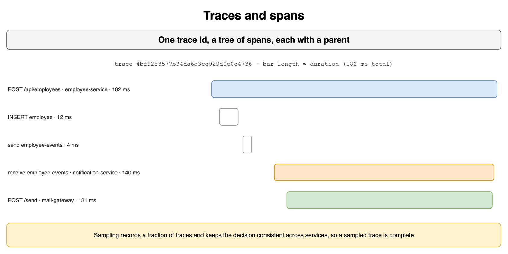
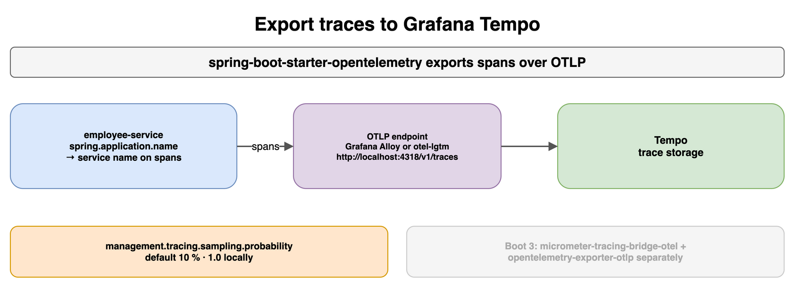
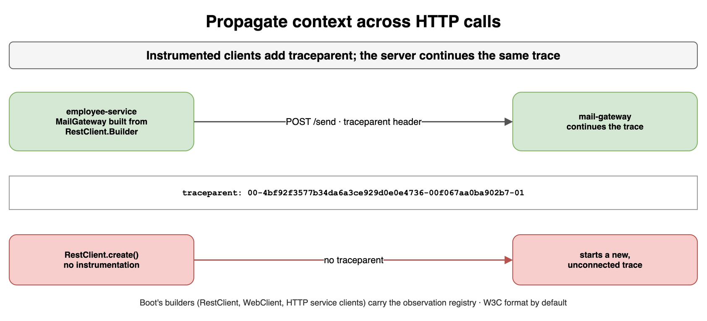
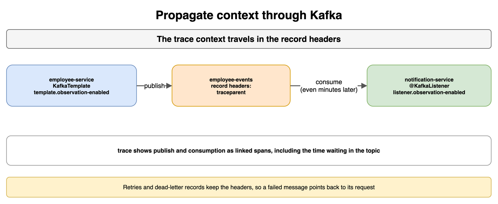
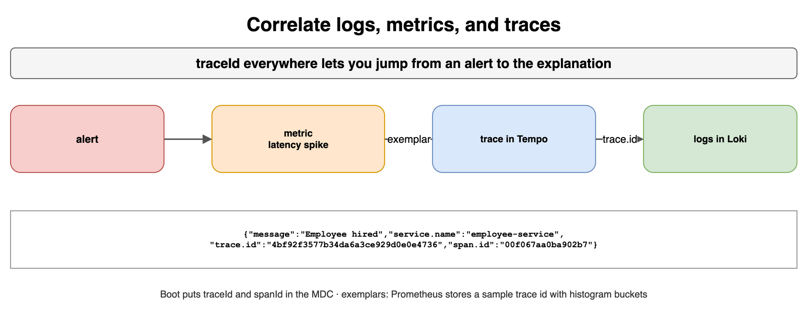
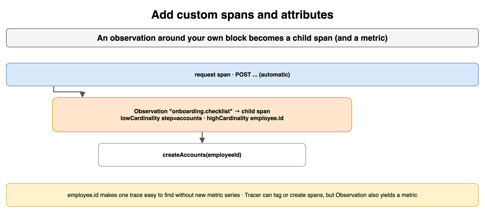

# Distributed Tracing and Correlation

## Traces and spans

A trace records the path of one request through a system. It is a tree of spans: each span covers one unit of work, such as an incoming HTTP request, a database query, or an outgoing call, with a start time, a duration, a status, and attributes. All spans of a trace share one trace id, and each span points to its parent.

A trace view shows at a glance where a slow request spent its time and which service returned the error. Tracing every request is expensive, so services sample: they record a fraction of traces and keep the decision consistent across services, so a sampled trace is complete.

```text
trace 4bf92f3577b34da6a3ce929d0e0e4736
└─ POST /api/employees          employee-service   182 ms
   ├─ INSERT employee            employee-service    12 ms
   ├─ send employee-events       employee-service     4 ms
   └─ receive employee-events    notification-service 140 ms
      └─ POST /send              mail-gateway       131 ms
```

[OpenTelemetry docs](https://opentelemetry.io/docs/concepts/signals/traces/)



*Source: [`diagrams/distributed-tracing.drawio`](/content/13_Spring_Boot/35_Distributed_Tracing_and_Correlation/diagrams/distributed-tracing.drawio), page 1.*

## Export traces to Grafana Tempo

Changed in Boot 4: add `spring-boot-starter-opentelemetry`, which brings Micrometer Tracing's OpenTelemetry bridge and the OTLP exporter. Boot 3 apps listed `micrometer-tracing-bridge-otel` and `opentelemetry-exporter-otlp` separately. Point the exporter at an OTLP endpoint, such as Grafana Alloy or the `otel-lgtm` container, which forwards spans to Tempo.

The default sampling probability is 10 percent. Use 1.0 locally to see every request, and a lower value in production. Set `spring.application.name`, which becomes the service name on every span.

```properties
spring.application.name=employee-service
management.tracing.sampling.probability=1.0
management.opentelemetry.tracing.export.otlp.endpoint=http://localhost:4318/v1/traces
```

[Spring Boot docs](https://docs.spring.io/spring-boot/reference/actuator/tracing.html)



*Source: [`diagrams/distributed-tracing.drawio`](/content/13_Spring_Boot/35_Distributed_Tracing_and_Correlation/diagrams/distributed-tracing.drawio), page 2.*

## Propagate context across HTTP calls

A trace crosses services only if each call carries the trace context. Boot uses the W3C `traceparent` header by default. Instrumented clients add it to outgoing requests, and the server instrumentation reads it and continues the same trace.

Context propagation works only with clients built from Boot's autoconfigured builders, such as `RestClient.Builder`, `WebClient.Builder`, and HTTP service clients. A client created with `RestClient.create()` skips the instrumentation, so the downstream service starts a new, unconnected trace.

```java
import org.springframework.stereotype.Component;
import org.springframework.web.client.RestClient;

@Component
class MailGateway {
    private final RestClient client;

    // The injected builder carries the observation registry, so calls are traced.
    MailGateway(RestClient.Builder builder) {
        this.client = builder.baseUrl("http://localhost:8090").build();
    }

    void send(String email) {
        client.post().uri("/send").body(email).retrieve().toBodilessEntity();
    }
}
```

```text
traceparent: 00-4bf92f3577b34da6a3ce929d0e0e4736-00f067aa0ba902b7-01
```

[Spring Boot docs](https://docs.spring.io/spring-boot/reference/actuator/tracing.html#actuator.micrometer-tracing.propagating-traces)



*Source: [`diagrams/distributed-tracing.drawio`](/content/13_Spring_Boot/35_Distributed_Tracing_and_Correlation/diagrams/distributed-tracing.drawio), page 3.*

## Propagate context through Kafka

Messaging breaks the request chain unless the trace context travels in the message. Turn on observation for the Kafka template and listener containers. The producer then writes `traceparent` into the record headers, and the listener continues the trace when it consumes the record, even minutes later.

The trace then shows the publish and the consumption as linked spans across services, including the time the message waited in the topic. Retries and dead-letter records keep the headers, so a failed message still points back to the request that caused it.

```properties
spring.kafka.template.observation-enabled=true
spring.kafka.listener.observation-enabled=true
```

[Spring Kafka docs](https://docs.spring.io/spring-kafka/reference/kafka/micrometer.html#observation)



*Source: [`diagrams/distributed-tracing.drawio`](/content/13_Spring_Boot/35_Distributed_Tracing_and_Correlation/diagrams/distributed-tracing.drawio), page 4.*

## Correlate logs, metrics, and traces

With tracing on, Boot puts the current `traceId` and `spanId` into the logging MDC. Structured logs include them as fields, and text logs show them in the correlation part of each line. In Grafana, a link from a Tempo span to Loki can then show the logs for that trace, and a log line's trace id opens the trace.

Metrics connect through exemplars: Prometheus stores a sample trace id with histogram buckets, so a latency spike on a dashboard links to a trace that shows it. Together, an alert leads to a metric, the metric to a trace, and the trace to the logs that explain the failure.

```properties
logging.structured.format.console=ecs
management.prometheus.metrics.export.enabled=true
management.metrics.distribution.percentiles-histogram.http.server.requests=true
```

```json
{"@timestamp":"2026-11-19T10:15:02Z","log.level":"INFO","message":"Employee hired","service.name":"employee-service","trace.id":"4bf92f3577b34da6a3ce929d0e0e4736","span.id":"00f067aa0ba902b7"}
```

[Spring Boot docs](https://docs.spring.io/spring-boot/reference/actuator/tracing.html#actuator.micrometer-tracing.logging)



*Source: [`diagrams/distributed-tracing.drawio`](/content/13_Spring_Boot/35_Distributed_Tracing_and_Correlation/diagrams/distributed-tracing.drawio), page 5.*

## Add custom spans and attributes

The automatic spans cover framework calls. For a slow block inside your own code, create an observation around it; the span appears as a child of the current request. Add a high-cardinality key value, such as an employee id, to make one trace easy to find without creating new metric series.

The `Tracer` API also lets you add a tag to the current span or create spans directly, but the Observation API is preferred because one call produces a metric too.

```java
import io.micrometer.observation.Observation;
import io.micrometer.observation.ObservationRegistry;
import org.springframework.stereotype.Service;

@Service
class OnboardingService {
    private final ObservationRegistry registry;

    OnboardingService(ObservationRegistry registry) {
        this.registry = registry;
    }

    void onboard(long employeeId) {
        Observation.createNotStarted("onboarding.checklist", registry)
                .lowCardinalityKeyValue("step", "accounts")
                .highCardinalityKeyValue("employee.id", String.valueOf(employeeId))
                .observe(() -> createAccounts(employeeId));
    }

    private void createAccounts(long employeeId) {
    }
}
```

[Micrometer docs](https://docs.micrometer.io/micrometer/reference/observation/introduction.html)



*Source: [`diagrams/distributed-tracing.drawio`](/content/13_Spring_Boot/35_Distributed_Tracing_and_Correlation/diagrams/distributed-tracing.drawio), page 6.*
