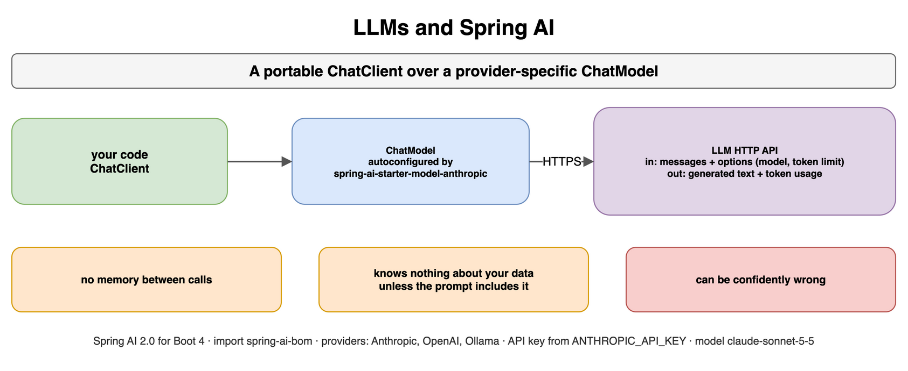
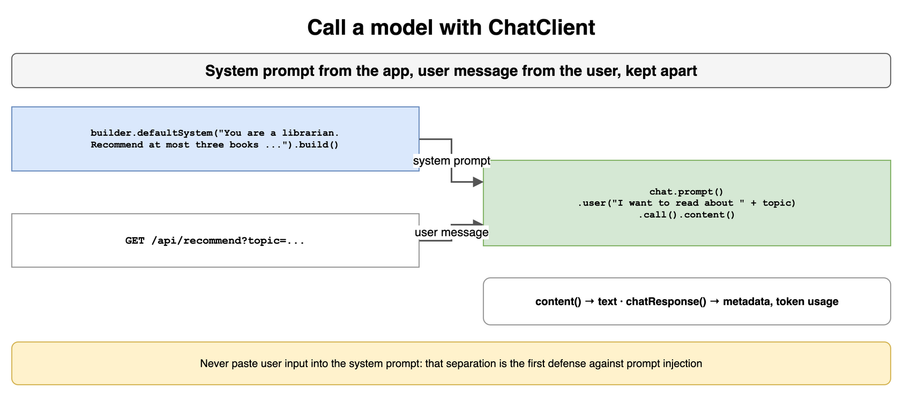
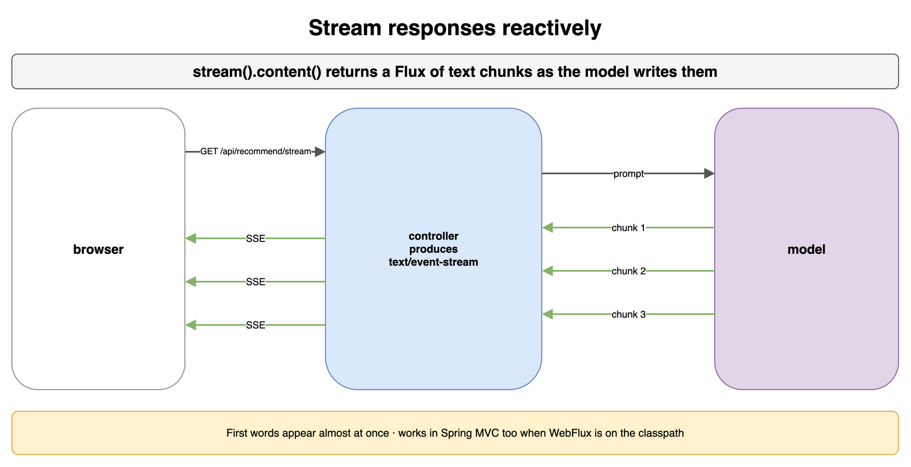
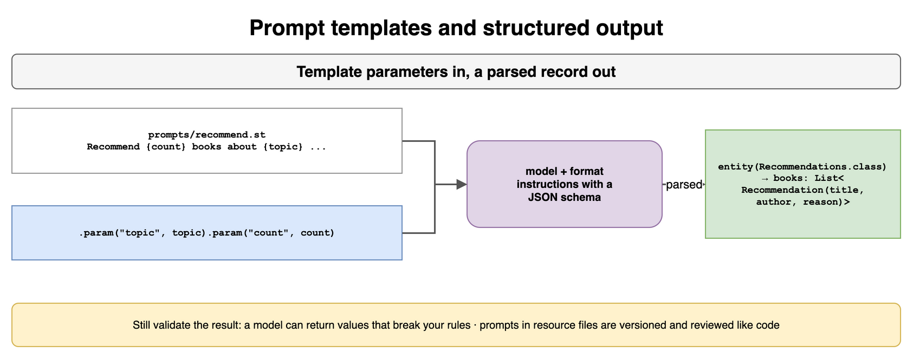
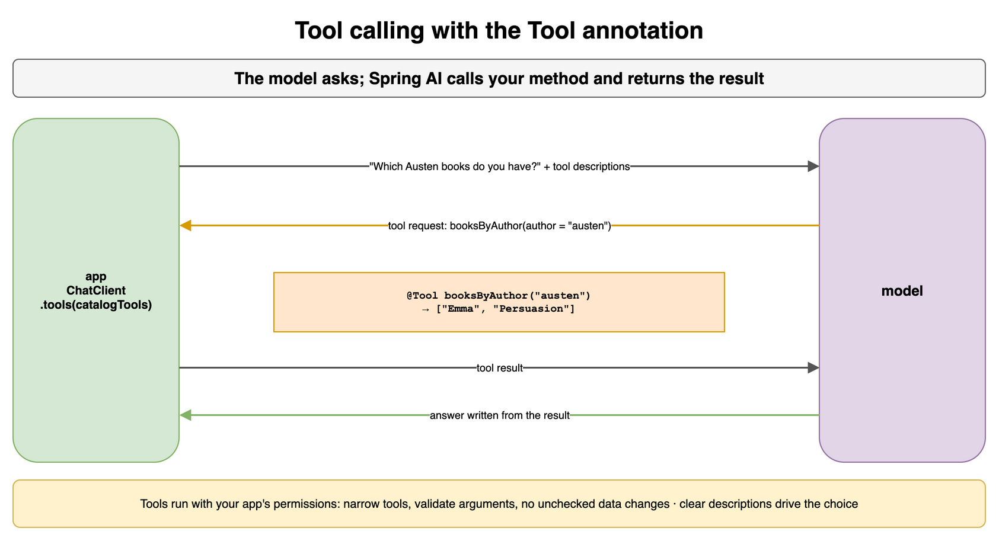
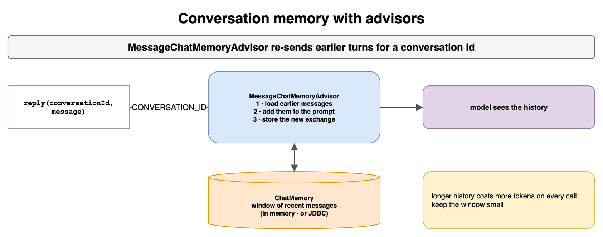

# Spring AI ChatClient, Prompts, and Tools

## LLMs and Spring AI

A large language model (LLM) predicts text from a prompt. Applications call it over an HTTP API: they send messages and options such as the model name and token limit, and receive generated text plus token usage. The model has no memory between calls and knows nothing about your data unless the prompt includes it. Its answers can be wrong in a confident tone.

Spring AI gives these APIs a Spring programming model. A starter per provider, such as Anthropic, OpenAI, or Ollama, autoconfigures a `ChatModel`, and the portable `ChatClient` API works with any of them. Spring AI 2.0 is the line built for Spring Boot 4. Import its BOM and keep API keys in environment variables.

```xml
<dependencyManagement>
  <dependencies>
    <dependency>
      <groupId>org.springframework.ai</groupId>
      <artifactId>spring-ai-bom</artifactId>
      <version>${spring-ai.version}</version>
      <type>pom</type>
      <scope>import</scope>
    </dependency>
  </dependencies>
</dependencyManagement>
<dependency>
  <groupId>org.springframework.ai</groupId>
  <artifactId>spring-ai-starter-model-anthropic</artifactId>
</dependency>
```

```properties
spring.ai.anthropic.api-key=${ANTHROPIC_API_KEY}
spring.ai.anthropic.chat.options.model=claude-sonnet-5-5
```

[Spring AI docs](https://docs.spring.io/spring-ai/reference/getting-started.html)



*Source: [`diagrams/spring-ai-chat.drawio`](/content/13_Spring_Boot/36_Spring_AI_ChatClient_Prompts_and_Tools/diagrams/spring-ai-chat.drawio), page 1.*

## Call a model with ChatClient

Boot provides a `ChatClient.Builder`. Build a client once, optionally with a default system prompt that sets the assistant's role and rules. Each call chains `prompt()`, the user message, `call()`, and a result method: `content()` for text or `chatResponse()` for metadata such as token usage.

The system prompt is instructions from the application; the user message is input from the user. Keep them apart, and never paste user input into the system prompt. That separation is the first defense against [prompt injection](#13_Spring_Boot/38_MCP_Evaluation_and_AI_Security/concepts/secure-an-ai-application).

```java
import org.springframework.ai.chat.client.ChatClient;
import org.springframework.web.bind.annotation.GetMapping;
import org.springframework.web.bind.annotation.RequestParam;
import org.springframework.web.bind.annotation.RestController;

@RestController
class LibrarianController {
    private final ChatClient chat;

    LibrarianController(ChatClient.Builder builder) {
        this.chat = builder
                .defaultSystem("You are a librarian. Recommend at most three books and explain why in one sentence each.")
                .build();
    }

    @GetMapping("/api/recommend")
    String recommend(@RequestParam String topic) {
        return chat.prompt().user("I want to read about " + topic).call().content();
    }
}
```

[Spring AI docs](https://docs.spring.io/spring-ai/reference/api/chatclient.html)



*Source: [`diagrams/spring-ai-chat.drawio`](/content/13_Spring_Boot/36_Spring_AI_ChatClient_Prompts_and_Tools/diagrams/spring-ai-chat.drawio), page 2.*

## Stream responses reactively

A long answer can take many seconds to generate. Streaming sends tokens to the user as the model produces them, so the first words appear almost at once. Replace `call()` with `stream()`, and `content()` returns a `Flux<String>` of text chunks.

Return that flux from a controller with `text/event-stream`, and the browser receives each chunk as a server-sent event. This works in Spring MVC as well as WebFlux, because Spring MVC can write a `Flux` asynchronously when WebFlux is on the classpath.

```java
import org.springframework.http.MediaType;
import org.springframework.web.bind.annotation.GetMapping;
import org.springframework.web.bind.annotation.RequestParam;
import reactor.core.publisher.Flux;

@GetMapping(path = "/api/recommend/stream", produces = MediaType.TEXT_EVENT_STREAM_VALUE)
Flux<String> stream(@RequestParam String topic) {
    return chat.prompt().user("I want to read about " + topic).stream().content();
}
```

[Spring AI docs](https://docs.spring.io/spring-ai/reference/api/chatclient.html#_streaming_responses)



*Source: [`diagrams/spring-ai-chat.drawio`](/content/13_Spring_Boot/36_Spring_AI_ChatClient_Prompts_and_Tools/diagrams/spring-ai-chat.drawio), page 3.*

## Prompt templates and structured output

Prompt engineering is the practice of writing prompts that make the model reliable: a clear role, explicit rules, examples, and a required output format. Inline parameters keep a prompt readable: write `{topic}` in the text and supply the value with `param`. Larger prompts can live in resource files as templates, so they are versioned and reviewed like code.

`entity(Class)` asks for structured output. Spring AI adds format instructions with a JSON schema derived from the record, then parses the reply into the record. Validate the result anyway, because a model can still return values that break your rules.

```java
import java.util.List;
import org.springframework.beans.factory.annotation.Value;
import org.springframework.core.io.Resource;

record Recommendation(String title, String author, String reason) {}
record Recommendations(List<Recommendation> books) {}

@Value("classpath:prompts/recommend.st")
Resource recommendPrompt;

Recommendations recommendations(String topic, int count) {
    return chat.prompt()
            .user(u -> u.text(recommendPrompt).param("topic", topic).param("count", count))
            .call()
            .entity(Recommendations.class);
}
```

```text
# src/main/resources/prompts/recommend.st
Recommend {count} books about {topic} for a curious beginner.
Prefer books still in print.
```

[Spring AI docs](https://docs.spring.io/spring-ai/reference/api/structured-output-converter.html)



*Source: [`diagrams/spring-ai-chat.drawio`](/content/13_Spring_Boot/36_Spring_AI_ChatClient_Prompts_and_Tools/diagrams/spring-ai-chat.drawio), page 4.*

## Tool calling with the Tool annotation

A model cannot look anything up by itself. With tool calling, the application describes methods the model may use. When the model decides it needs one, it returns a tool request with arguments; Spring AI calls your method and sends the result back, and the model writes its answer from it.

Annotate methods with `@Tool` and a clear description, because the model chooses tools from descriptions. Pass the object to `tools(...)` per request or `defaultTools(...)` on the builder. Tools run with your application's permissions, so keep them narrow, validate the arguments, and never expose a tool that changes data without a check.

```java
import java.util.List;
import org.springframework.ai.tool.annotation.Tool;
import org.springframework.ai.tool.annotation.ToolParam;
import org.springframework.stereotype.Component;

@Component
class CatalogTools {
    @Tool(description = "Find books in the library catalog by author last name")
    List<String> booksByAuthor(@ToolParam(description = "Author last name") String author) {
        return switch (author.toLowerCase()) {
            case "austen" -> List.of("Emma", "Persuasion");
            case "herbert" -> List.of("Dune");
            default -> List.of();
        };
    }
}

// In the controller:
// chat.prompt().user("Which Austen books do you have?").tools(catalogTools).call().content();
```

[Spring AI docs](https://docs.spring.io/spring-ai/reference/api/tools.html)



*Source: [`diagrams/spring-ai-chat.drawio`](/content/13_Spring_Boot/36_Spring_AI_ChatClient_Prompts_and_Tools/diagrams/spring-ai-chat.drawio), page 5.*

## Conversation memory with advisors

Each model call is stateless, so a chat that remembers earlier turns must send them again. Advisors are interceptors around a `ChatClient` call. `MessageChatMemoryAdvisor` loads earlier messages for a conversation id from a `ChatMemory`, adds them to the prompt, and stores the new exchange afterwards.

Boot configures a `ChatMemory` that keeps a window of recent messages, in memory by default; a JDBC repository stores them durably. Pass the conversation id per request. Longer history costs more tokens on every call, so keep the window small.

```java
import org.springframework.ai.chat.client.ChatClient;
import org.springframework.ai.chat.client.advisor.MessageChatMemoryAdvisor;
import org.springframework.ai.chat.memory.ChatMemory;

ChatClient chat = builder
        .defaultAdvisors(MessageChatMemoryAdvisor.builder(chatMemory).build())
        .build();

String reply(String conversationId, String message) {
    return chat.prompt()
            .user(message)
            .advisors(a -> a.param(ChatMemory.CONVERSATION_ID, conversationId))
            .call()
            .content();
}
```

[Spring AI docs](https://docs.spring.io/spring-ai/reference/api/chat-memory.html)



*Source: [`diagrams/spring-ai-chat.drawio`](/content/13_Spring_Boot/36_Spring_AI_ChatClient_Prompts_and_Tools/diagrams/spring-ai-chat.drawio), page 6.*
