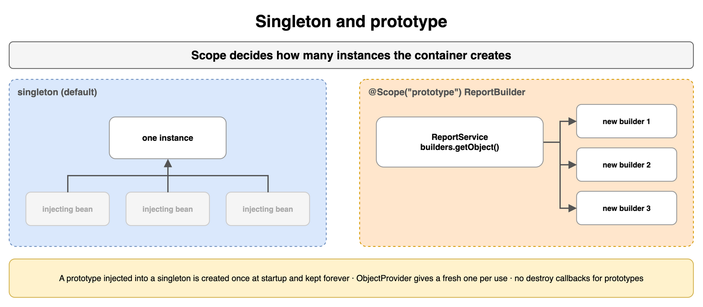
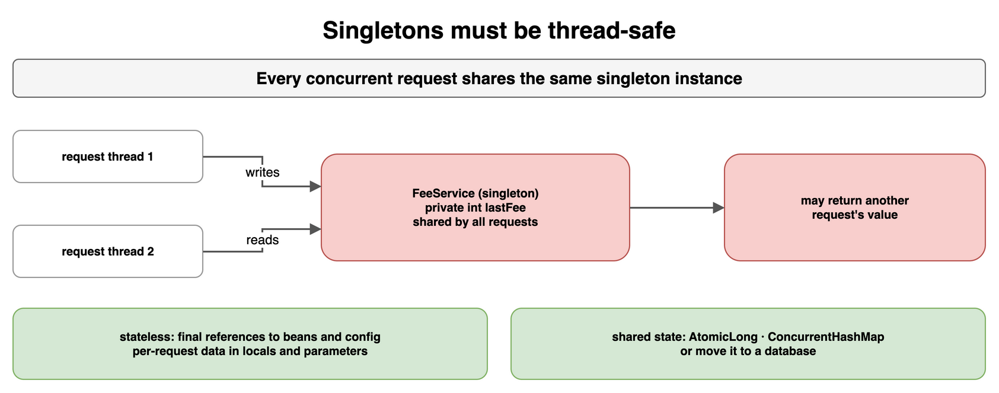
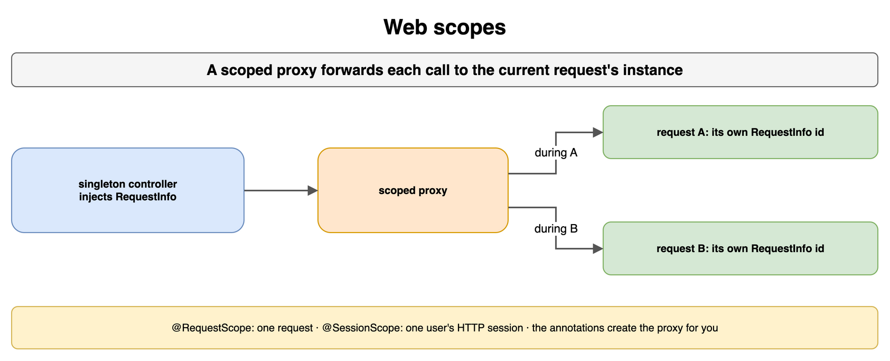
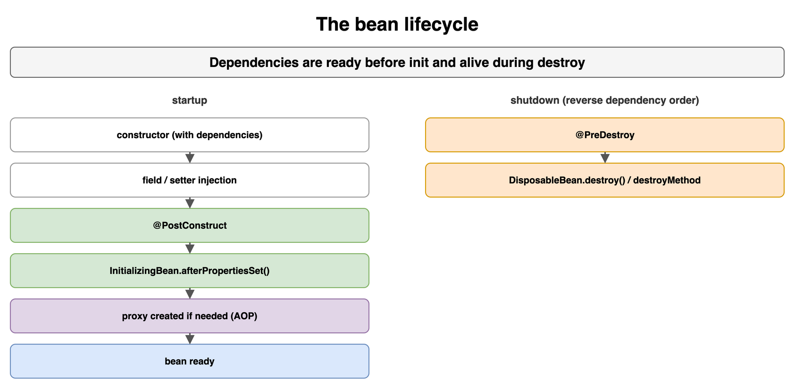
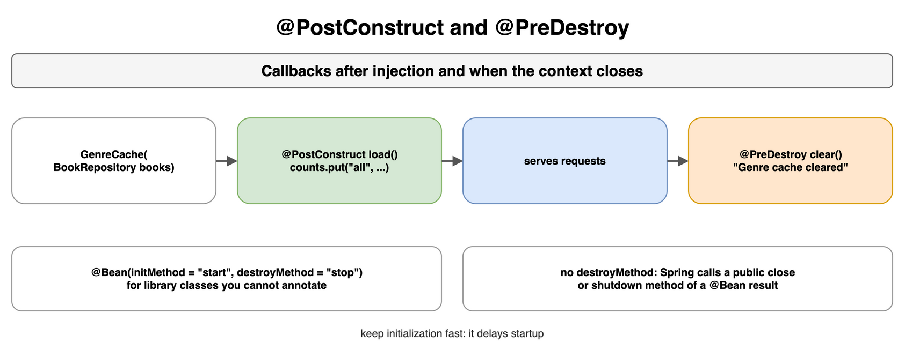
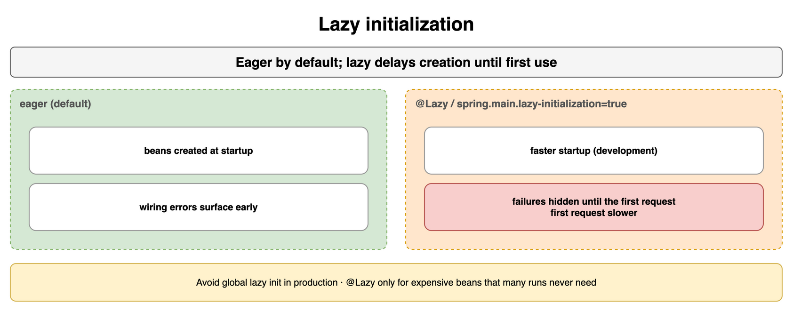

# Bean Scopes and Lifecycle

## Singleton and prototype

A bean's scope decides how many instances the container creates. The default, singleton, means one instance per application context, created at startup and shared by every bean that injects it. Most beans are singletons: services, repositories, controllers, and clients.

`@Scope("prototype")` creates a new instance every time the bean is requested. Injecting a prototype into a singleton happens once, at startup, so the singleton keeps that one instance forever. To get a fresh instance per use, ask an `ObjectProvider` each time. The container does not call destroy callbacks for prototypes; the caller owns them.

```java
import org.springframework.beans.factory.ObjectProvider;
import org.springframework.context.annotation.Scope;
import org.springframework.stereotype.Component;
import org.springframework.stereotype.Service;

@Component
@Scope("prototype")
class ReportBuilder {
    private final StringBuilder text = new StringBuilder();

    ReportBuilder line(String line) {
        text.append(line).append('\n');
        return this;
    }

    String build() {
        return text.toString();
    }
}

@Service
class ReportService {
    private final ObjectProvider<ReportBuilder> builders;

    ReportService(ObjectProvider<ReportBuilder> builders) {
        this.builders = builders;
    }

    String report() {
        return builders.getObject().line("Loans: 12").build(); // A new builder each call.
    }
}
```

[Spring Framework docs](https://docs.spring.io/spring-framework/reference/core/beans/factory-scopes.html)



*Source: [`diagrams/scopes-and-lifecycle.drawio`](/content/13_Spring_Boot/37_Bean_Scopes_and_Lifecycle/diagrams/scopes-and-lifecycle.drawio), page 1.*

## Singletons must be thread-safe

A web server handles many requests at once on different threads, and they all use the same singleton instances. A mutable field in a singleton is therefore shared by every request. If one request writes it while another reads it, results mix between users.

Keep singletons stateless: hold only final references to other beans and configuration, and keep per-request data in local variables and parameters. When shared state is truly needed, such as a counter or cache, use a thread-safe type like `AtomicLong` or `ConcurrentHashMap`, or move the state to a database.

```java
import org.springframework.stereotype.Service;

@Service
class FeeService {
    private int lastFee; // Bug: shared by all concurrent requests.

    int fee(int daysLate) {
        lastFee = daysLate * 50;
        return lastFee; // May return another request's value.
    }

    int safeFee(int daysLate) {
        int fee = daysLate * 50; // Local variable: private to this call.
        return fee;
    }
}
```

[Spring Framework docs](https://docs.spring.io/spring-framework/reference/core/beans/factory-scopes.html#beans-factory-scopes-singleton)



*Source: [`diagrams/scopes-and-lifecycle.drawio`](/content/13_Spring_Boot/37_Bean_Scopes_and_Lifecycle/diagrams/scopes-and-lifecycle.drawio), page 2.*

## Web scopes

Web applications add scopes tied to HTTP. A `@RequestScope` bean lives for one request, and a `@SessionScope` bean for one user's HTTP session. They suit per-request context, such as a correlation id or a request-level cache.

A singleton cannot hold a request-scoped instance directly, because it is created once at startup when there is no request. Spring injects a scoped proxy instead: each method call on the proxy forwards to the instance for the current request. These annotations create the proxy for you.

```java
import java.util.UUID;
import org.springframework.stereotype.Component;
import org.springframework.web.context.annotation.RequestScope;

@Component
@RequestScope
class RequestInfo {
    private final String id = UUID.randomUUID().toString();

    String id() {
        return id;
    }
}

// A singleton controller can inject RequestInfo; every request sees its own id.
```

[Spring Framework docs](https://docs.spring.io/spring-framework/reference/core/beans/factory-scopes.html#beans-factory-scopes-other-injection)



*Source: [`diagrams/scopes-and-lifecycle.drawio`](/content/13_Spring_Boot/37_Bean_Scopes_and_Lifecycle/diagrams/scopes-and-lifecycle.drawio), page 3.*

## The bean lifecycle

For each singleton, the container runs the same steps at startup. It calls the constructor with the dependencies, injects any field or setter dependencies, then calls initialization callbacks. Next, post-processors may wrap the bean in a [proxy](#13_Spring_Boot/39_Proxies_and_AOP) for features such as transactions. Only then is the bean handed to others.

At shutdown, the context destroys singletons in reverse dependency order and calls their destroy callbacks. The order matters: a bean's dependencies are ready before its own initialization runs, and are still alive while its destroy callback runs.

```text
startup                                  shutdown
 ├─ constructor (with dependencies)       ├─ @PreDestroy
 ├─ field / setter injection              └─ DisposableBean.destroy() / destroyMethod
 ├─ @PostConstruct
 ├─ InitializingBean.afterPropertiesSet()
 ├─ proxy created if needed (AOP)
 └─ bean ready
```

[Spring Framework docs](https://docs.spring.io/spring-framework/reference/core/beans/factory-nature.html)



*Source: [`diagrams/scopes-and-lifecycle.drawio`](/content/13_Spring_Boot/37_Bean_Scopes_and_Lifecycle/diagrams/scopes-and-lifecycle.drawio), page 4.*

## @PostConstruct and @PreDestroy

`@PostConstruct` runs once after all dependencies are injected, so it can safely use them: validate settings, warm a cache, or open a connection. `@PreDestroy` runs when the context closes, for example on graceful shutdown: flush buffers, close connections, stop threads. Both come from Jakarta Annotations.

For `@Bean` methods, use `@Bean(initMethod = "start", destroyMethod = "stop")` to call methods on a library class you cannot annotate. Without a `destroyMethod`, Spring calls a public `close` or `shutdown` method of a `@Bean` result automatically. Keep initialization fast, because it delays startup.

```java
import jakarta.annotation.PostConstruct;
import jakarta.annotation.PreDestroy;
import java.util.Map;
import java.util.concurrent.ConcurrentHashMap;
import org.springframework.stereotype.Component;

@Component
class GenreCache {
    private final BookRepository books;
    private final Map<String, Long> counts = new ConcurrentHashMap<>();

    GenreCache(BookRepository books) {
        this.books = books;
    }

    @PostConstruct
    void load() {
        counts.put("all", (long) books.titles().size());
    }

    @PreDestroy
    void clear() {
        counts.clear();
        System.out.println("Genre cache cleared");
    }
}
```

[Spring Framework docs](https://docs.spring.io/spring-framework/reference/core/beans/annotation-config/postconstruct-and-predestroy-annotations.html)



*Source: [`diagrams/scopes-and-lifecycle.drawio`](/content/13_Spring_Boot/37_Bean_Scopes_and_Lifecycle/diagrams/scopes-and-lifecycle.drawio), page 5.*

## Lazy initialization

Singletons are created eagerly at startup by default, which surfaces wiring errors early. `@Lazy` on a bean delays creation until first use. `spring.main.lazy-initialization=true` makes every bean lazy, which shortens startup in development.

Lazy beans hide failures until the first request that needs them, and the first request is slower. Avoid global lazy initialization in production; use `@Lazy` only for expensive beans that many runs never need.

```properties
# Development only: faster startup, later failures.
spring.main.lazy-initialization=true
```

[Spring Boot docs](https://docs.spring.io/spring-boot/reference/features/spring-application.html#features.spring-application.lazy-initialization)



*Source: [`diagrams/scopes-and-lifecycle.drawio`](/content/13_Spring_Boot/37_Bean_Scopes_and_Lifecycle/diagrams/scopes-and-lifecycle.drawio), page 6.*
