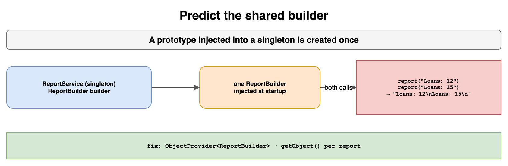
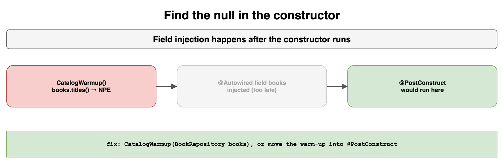

# Bean Scopes and Lifecycle — Drills

Predict the result before running the example.

## Predict the shared builder

`ReportBuilder` is prototype-scoped, as in [singleton and prototype](#13_Spring_Boot/37_Bean_Scopes_and_Lifecycle/concepts/singleton-and-prototype). The service below is called twice. What does the second call return?

```java
@Service
class ReportService {
    private final ReportBuilder builder;

    ReportService(ReportBuilder builder) {
        this.builder = builder;
    }

    String report(String line) {
        return builder.line(line).build();
    }
}
```

```java
reportService.report("Loans: 12");
reportService.report("Loans: 15");
```

**Answer**

`"Loans: 12\nLoans: 15\n"`. The prototype was injected once, when the singleton service was created, so both calls share one builder and its text accumulates. Inject `ObjectProvider<ReportBuilder>` and call `getObject()` per report to get a new builder each time.



*Source: [`diagrams/scopes-and-lifecycle-drills.drawio`](/content/13_Spring_Boot/37_Bean_Scopes_and_Lifecycle/diagrams/scopes-and-lifecycle-drills.drawio), page 1.*

## Find the null in the constructor

This bean fails at startup with a `NullPointerException`. Why, and how do you fix it?

```java
@Component
class CatalogWarmup {
    @Autowired
    private BookRepository books;

    CatalogWarmup() {
        System.out.println("Warming " + books.titles().size() + " titles");
    }
}
```

**Answer**

Field injection happens after the constructor runs, so `books` is still null inside it. Use constructor injection, `CatalogWarmup(BookRepository books)`, or move the warm-up into a `@PostConstruct` method, which runs after injection. See [the bean lifecycle](#13_Spring_Boot/37_Bean_Scopes_and_Lifecycle/concepts/the-bean-lifecycle).



*Source: [`diagrams/scopes-and-lifecycle-drills.drawio`](/content/13_Spring_Boot/37_Bean_Scopes_and_Lifecycle/diagrams/scopes-and-lifecycle-drills.drawio), page 2.*
