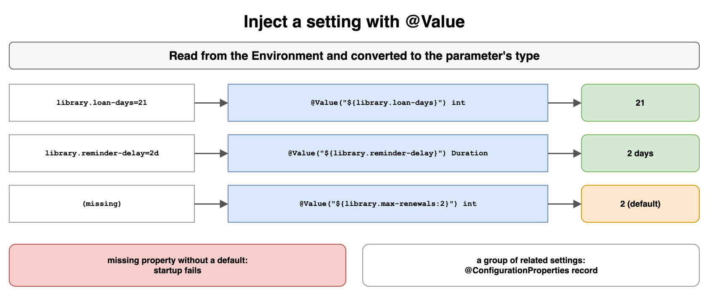
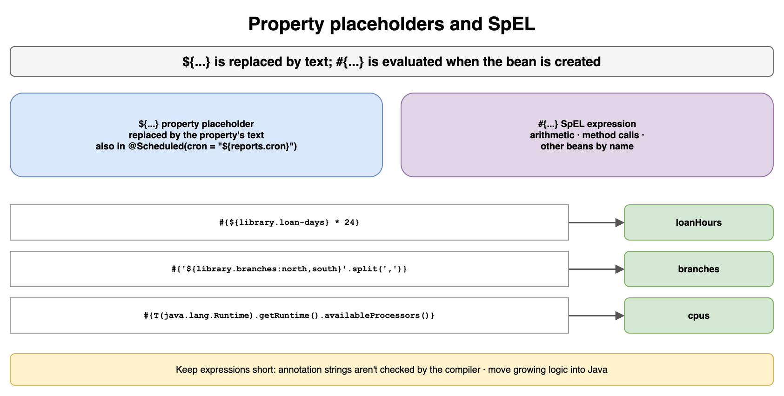
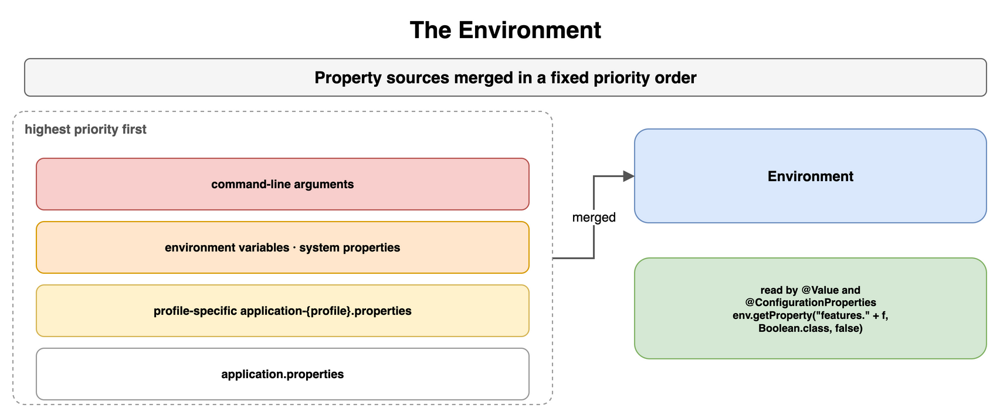
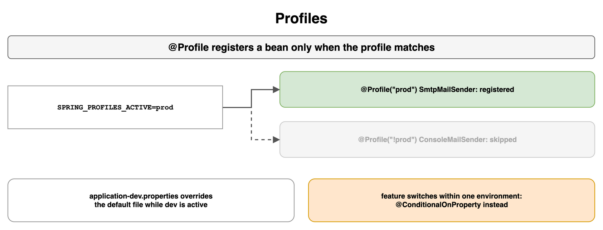
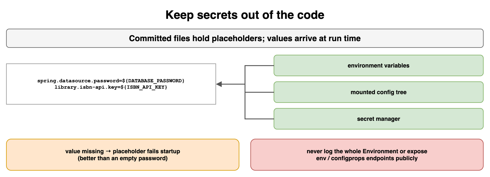

# Values, SpEL, Environment, and Profiles

## Inject a setting with @Value

`@Value("${key}")` injects one property into a constructor parameter or field. Spring reads the value from the `Environment` and converts it to the parameter's type: numbers, booleans, `Duration` values such as `30s`, and comma-separated lists. A default after a colon, `${key:default}`, applies when the property is missing; without one, a missing property fails startup.

`@Value` suits one or two simple settings. For a group of related settings, a [typed `@ConfigurationProperties` record](#13_Spring_Boot/02_Configuration_Properties_and_Dependency_Management/concepts/typed-custom-properties) is better: it validates the values, documents them, and keeps the keys in one place.

```properties
library.loan-days=21
library.reminder-delay=2d
```

```java
import java.time.Duration;
import org.springframework.beans.factory.annotation.Value;
import org.springframework.stereotype.Service;

@Service
class LoanPolicy {
    private final int loanDays;
    private final Duration reminderDelay;
    private final int maxRenewals;

    LoanPolicy(@Value("${library.loan-days}") int loanDays,
               @Value("${library.reminder-delay}") Duration reminderDelay,
               @Value("${library.max-renewals:2}") int maxRenewals) {
        this.loanDays = loanDays;
        this.reminderDelay = reminderDelay;
        this.maxRenewals = maxRenewals;
    }
}
```

[Spring Framework docs](https://docs.spring.io/spring-framework/reference/core/beans/annotation-config/value-annotations.html)



*Source: [`diagrams/values-and-profiles.drawio`](/content/13_Spring_Boot/38_Values_SpEL_Environment_and_Profiles/diagrams/values-and-profiles.drawio), page 1.*

## Property placeholders and SpEL

`${...}` is a property placeholder: it is replaced by the property's text. `#{...}` is a Spring Expression Language (SpEL) expression, evaluated when the bean is created. SpEL can do arithmetic, call methods, read other beans by name, and combine with placeholders, as in `#{${library.loan-days} * 24}`.

Keep expressions short. Logic in annotation strings is not checked by the compiler and is hard to test; if an expression grows beyond a simple calculation or default, move it into Java code. Placeholders also work inside other annotations, such as `@Scheduled(cron = "${reports.cron}")`.

```java
import org.springframework.beans.factory.annotation.Value;
import org.springframework.stereotype.Component;

@Component
class LoanLimits {
    LoanLimits(@Value("#{${library.loan-days} * 24}") int loanHours,
               @Value("#{'${library.branches:north,south}'.split(',')}") String[] branches,
               @Value("#{T(java.lang.Runtime).getRuntime().availableProcessors()}") int cpus) {
        System.out.println(loanHours + " hours, " + branches.length + " branches, " + cpus + " cpus");
    }
}
```

[Spring Framework docs](https://docs.spring.io/spring-framework/reference/core/expressions.html)



*Source: [`diagrams/values-and-profiles.drawio`](/content/13_Spring_Boot/38_Values_SpEL_Environment_and_Profiles/diagrams/values-and-profiles.drawio), page 2.*

## The Environment

The `Environment` is the container's view of configuration. It merges property sources in a fixed priority order: command-line arguments, then environment variables and system properties, then `application.properties` files, with profile-specific files above the default file. [Topic 14](#13_Spring_Boot/14_Profiles_YAML_and_Property_Overrides/concepts/the-order-of-property-overrides) lists the full order.

`@Value` and `@ConfigurationProperties` read from it. Code that needs a property chosen at run time can inject `Environment` and call `getProperty` with a type and default. It also reports the active profiles.

```java
import org.springframework.core.env.Environment;
import org.springframework.stereotype.Component;

@Component
class FeatureFlags {
    private final Environment env;

    FeatureFlags(Environment env) {
        this.env = env;
    }

    boolean enabled(String feature) {
        return env.getProperty("features." + feature, Boolean.class, false);
    }
}
```

[Spring Framework docs](https://docs.spring.io/spring-framework/reference/core/beans/environment.html)



*Source: [`diagrams/values-and-profiles.drawio`](/content/13_Spring_Boot/38_Values_SpEL_Environment_and_Profiles/diagrams/values-and-profiles.drawio), page 3.*

## Profiles

A profile is a named set of beans and settings for one environment, such as `dev`, `test`, or `prod`. Activate profiles with `spring.profiles.active`, usually from an environment variable or command-line argument rather than a file. `application-dev.properties` then overrides the default file while `dev` is active.

`@Profile` on a component or `@Bean` method registers it only when the profile matches; `!prod` means "not prod". Use profiles for environment differences such as a fake mail sender in development, not for feature switches inside one environment; a property with `@ConditionalOnProperty` fits that better.

```java
import org.springframework.context.annotation.Profile;
import org.springframework.stereotype.Component;

interface MailSender {
    void send(String to, String text);
}

@Component
@Profile("!prod")
class ConsoleMailSender implements MailSender {
    public void send(String to, String text) {
        System.out.println("MAIL to " + to + ": " + text);
    }
}

@Component
@Profile("prod")
class SmtpMailSender implements MailSender {
    public void send(String to, String text) { /* real SMTP */ }
}
```

```sh
SPRING_PROFILES_ACTIVE=prod java -jar target/study-0.0.1-SNAPSHOT.jar
```

[Spring Boot docs](https://docs.spring.io/spring-boot/reference/features/profiles.html)



*Source: [`diagrams/values-and-profiles.drawio`](/content/13_Spring_Boot/38_Values_SpEL_Environment_and_Profiles/diagrams/values-and-profiles.drawio), page 4.*

## Keep secrets out of the code

Properties files are committed with the code, so they must not hold passwords, API keys, or tokens. Reference them with placeholders and supply the values at run time through environment variables, a mounted config tree, or a secret manager. The placeholder fails startup when the value is missing, which is better than running with an empty password.

Never log the whole `Environment` or expose the `env` and `configprops` actuator endpoints publicly; Boot masks values by default for this reason. [Topic 14](#13_Spring_Boot/14_Profiles_YAML_and_Property_Overrides/concepts/environment-variables) shows how environment variable names map to property keys.

```properties
spring.datasource.password=${DATABASE_PASSWORD}
library.isbn-api.key=${ISBN_API_KEY}
```

[Spring Boot docs](https://docs.spring.io/spring-boot/reference/features/external-config.html)



*Source: [`diagrams/values-and-profiles.drawio`](/content/13_Spring_Boot/38_Values_SpEL_Environment_and_Profiles/diagrams/values-and-profiles.drawio), page 5.*
