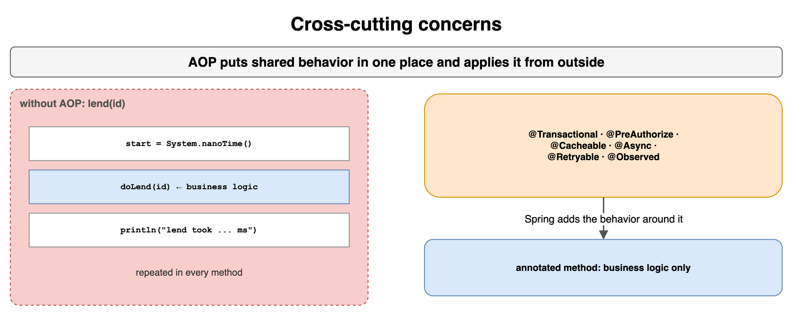
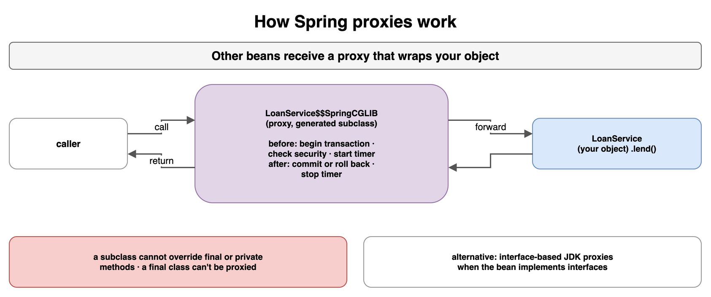
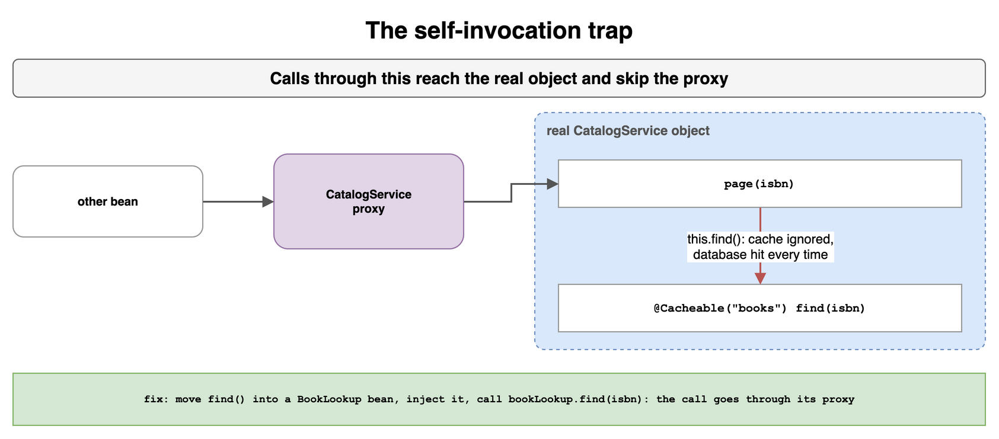
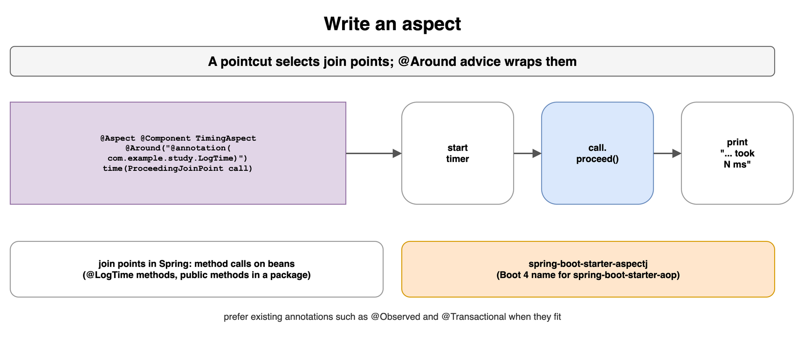

# Proxies and AOP

## Cross-cutting concerns

Some behavior applies to many methods across the app: transactions, security checks, caching, retries, timing, and auditing. Writing it into every method repeats the same code and buries the business logic. Aspect-oriented programming (AOP) puts that behavior in one place and applies it to selected methods from outside.

Many Spring annotations work this way: `@Transactional`, `@PreAuthorize`, `@Cacheable`, `@Async`, `@Retryable`, and `@Observed`. The annotation marks the method, and Spring adds the behavior around it. Understanding how that happens explains their most common surprises.

```java
// Without AOP: every method repeats the same wrapper code.
Book lend(long id) {
    long start = System.nanoTime();
    try {
        return doLend(id);
    } finally {
        System.out.println("lend took " + (System.nanoTime() - start) / 1_000_000 + " ms");
    }
}
```

[Spring Framework docs](https://docs.spring.io/spring-framework/reference/core/aop.html)



*Source: [`diagrams/proxies-and-aop.drawio`](/content/13_Spring_Boot/39_Proxies_and_AOP/diagrams/proxies-and-aop.drawio), page 1.*

## How Spring proxies work

When a bean needs extra behavior, Spring does not change your class. After creating the bean, it wraps it in a proxy, an object of the same type that intercepts each call, runs the extra behavior, and forwards to your real object. Other beans receive the proxy, not the original.

Spring Boot creates class-based proxies with CGLIB by default: a generated subclass of your class. A subclass cannot override `final` or `private` methods, so annotations on them have no effect, and a `final` class cannot be proxied at all. Interface-based JDK proxies are the alternative when a bean implements interfaces.

```text
caller ──► LoanService$$SpringCGLIB (proxy)
               │  begin transaction / check security / start timer
               ▼
           LoanService (your object) .lend()
               │
               ▼
           proxy: commit or roll back / stop timer ──► return to caller
```

```java
// Prints a generated proxy class name such as LoanService$$SpringCGLIB$$0
System.out.println(loanService.getClass().getName());
```

[Spring Framework docs](https://docs.spring.io/spring-framework/reference/core/aop/proxying.html)



*Source: [`diagrams/proxies-and-aop.drawio`](/content/13_Spring_Boot/39_Proxies_and_AOP/diagrams/proxies-and-aop.drawio), page 2.*

## The self-invocation trap

A proxy intercepts calls that come from outside the bean. When a method calls another method on the same object, the call goes through `this`, which is the real object, not the proxy. The annotation on the called method is skipped: no new transaction, no cache lookup, no security check, no async thread.

This is the most common AOP surprise. Fix it by moving the annotated method to a separate bean and calling that bean, which goes through its proxy. Injecting the bean into itself also works but is harder to follow.

```java
import org.springframework.cache.annotation.Cacheable;
import org.springframework.stereotype.Service;

@Service
class CatalogService {
    BookPage page(String isbn) {
        Book book = find(isbn); // Self-invocation: @Cacheable is ignored, the database is hit every time.
        return new BookPage(book);
    }

    @Cacheable("books")
    Book find(String isbn) {
        return loadFromDatabase(isbn);
    }
}

// Fix: move find() into a BookLookup bean, inject it, and call bookLookup.find(isbn).
```

[Spring Framework docs](https://docs.spring.io/spring-framework/reference/core/aop/proxying.html#aop-understanding-aop-proxies)



*Source: [`diagrams/proxies-and-aop.drawio`](/content/13_Spring_Boot/39_Proxies_and_AOP/diagrams/proxies-and-aop.drawio), page 3.*

## Write an aspect

An aspect is a class with advice: code that runs at selected join points, which in Spring are method calls on beans. A pointcut expression selects them, for example every method annotated with `@Timed` or every public method in a package. `@Around` advice wraps the call and decides when to proceed.

Add `spring-boot-starter-aspectj`, which Boot 4 renamed from `spring-boot-starter-aop`, then declare the aspect as a bean with `@Aspect` and `@Component`. Prefer existing annotations such as `@Observed` and `@Transactional` when they fit; write your own aspect for a concern specific to your app.

```java
import java.lang.annotation.ElementType;
import java.lang.annotation.Retention;
import java.lang.annotation.RetentionPolicy;
import java.lang.annotation.Target;
import org.aspectj.lang.ProceedingJoinPoint;
import org.aspectj.lang.annotation.Around;
import org.aspectj.lang.annotation.Aspect;
import org.springframework.stereotype.Component;

@Target(ElementType.METHOD)
@Retention(RetentionPolicy.RUNTIME)
@interface LogTime {
}

@Aspect
@Component
class TimingAspect {
    @Around("@annotation(com.example.study.LogTime)")
    Object time(ProceedingJoinPoint call) throws Throwable {
        long start = System.nanoTime();
        try {
            return call.proceed();
        } finally {
            System.out.println(call.getSignature().toShortString() + " took "
                    + (System.nanoTime() - start) / 1_000_000 + " ms");
        }
    }
}
```

[Spring Framework docs](https://docs.spring.io/spring-framework/reference/core/aop/ataspectj.html)



*Source: [`diagrams/proxies-and-aop.drawio`](/content/13_Spring_Boot/39_Proxies_and_AOP/diagrams/proxies-and-aop.drawio), page 4.*

## Proxy limits to remember

Proxy-based features apply only to beans, only to calls that arrive through the proxy, and only to methods the proxy can override. An object created with `new`, a self-invocation, a `private` method, a `final` method, or a call made inside the constructor or `@PostConstruct` all bypass the extra behavior.

When an annotation seems to do nothing, check these cases first. A quick test: print `getClass()` on the injected bean to confirm it is a proxy, and check that the call comes from another bean.

| Case | Annotation applied? |
|---|---|
| Call from another bean to a public method | Yes |
| Call from a method of the same object | No |
| `private` or `final` method | No |
| Object created with `new` | No |
| Call from the constructor or `@PostConstruct` | No |

[Spring Framework docs](https://docs.spring.io/spring-framework/reference/core/aop/proxying.html)
