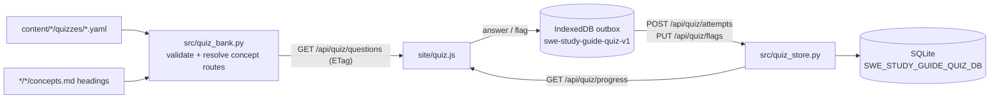

# Quiz

The site has a central quiz at `#_quiz` (sidebar **Quiz**, the welcome card, or
the **N quizzes** badge on a technology page). It is separate from the topic
pages. Every question is linked to exactly one concept card, and all history is
kept on the server so it is shared between devices. Design: issue #72, ported
from the AWS SA Course quiz (aws-sa-course #79).

## Using it

- **Builder (`#_quiz`)**: a tree of technology → quiz set → topic with
  tri-state checkboxes. Pick whole technologies, whole quiz sets, or single
  topics inside a quiz set. Choose what to include (all, unanswered, previously
  wrong, wrong last time, flagged), whether to shuffle questions and answers,
  and the session length. **All flagged questions** selects everything with the
  flagged filter. Selections are remembered in the browser.
- **Session (`#_quiz/run`)**: submit an answer to see whether it was right, the
  explanation, and **Review concept →**. That link opens the concept card with a
  **← Back to quiz** button that returns to the same question. Questions with
  more than one correct answer say "Select all that apply (N)" and are graded
  all-or-nothing. **Flag** marks a question for later. Reloading the page or
  leaving for a concept card resumes the session.
- **Summary**: score, time, per-technology breakdown, missed questions with
  concept links, and **Retry missed**.
- **Progress (`#_quiz/progress`)**: totals, a per-technology table, a per-quiz
  table, weak concepts (lowest accuracy first, then most wrong answers), and a
  question list filterable by technology, quiz and state, with flag toggles.
- **Deep links** preset the builder:
  - `#_quiz?technology=<techDir>`
  - `#_quiz?quiz=<techDir>/<quizId>`
  - `#_quiz?concept=<techDir>/<topicDir>/concepts/<slug>`
  - `#_quiz?filter=flagged|wrong|wrong-last|unanswered|all`
- Concept cards also have their own deep link:
  `#<techDir>/<topicDir>/concepts/<slug>`.

## Writing quizzes: `content/<TECH>/quizzes/<quiz-id>.yaml`

A technology can have **any number of quiz sets**. Add a quiz by dropping a new
YAML file into `content/<TECH>/quizzes/`; no code change is needed. The file
name (without `.yaml`) is the quiz id: `[a-z0-9][a-z0-9_-]*`. A legacy
`content/<TECH>/quiz.yaml` is also read, with quiz id `quiz`.

```yaml
version: 1
title: "Algorithmic Complexity: Fundamentals"   # shown in the builder; defaults to the file name
description: Big O vocabulary and simplification rules.   # optional
questions:
  - id: drop-constants-simplify      # stable, unique across ALL quiz files of this technology
    topic: 01_Algorithmic_Complexity # a topic directory in this technology
    concept: Dropping constants and non-dominant terms   # a "## " heading in that topic's concepts.md
    prompt: Simplify O(3N² + 5N + 12).
    choices:
      - { id: a, text: "O(3N²)" }
      - { id: b, text: "O(N²)" }
    answer: [b]                      # 2+ ids makes it "select all that apply"
    explanation: Drop constant factors and lower-order terms.
    placeholder: true                # optional; shows a "Placeholder" badge
```

- `prompt`, choice `text` and `explanation` are Markdown (code blocks work).
- A quiz set may span several topics of its technology. The builder shows each
  topic as its own row under the quiz set.
- Concept matching uses the same `slugify()` as concept deep links, so case and
  punctuation differences are tolerated (`aren't` matches `aren’t`).
- **History is keyed by `<techDir>/<id>`.** Rewording a question, or moving it
  to another quiz file in the same technology, keeps its history. If a question
  starts testing something different, give it a new id. Never reuse an id for a
  different question. A duplicate id across two quiz files of one technology is
  reported as an issue and neither copy is served.
- Invalid questions are skipped at runtime and listed on the builder page.
  `tests/test_quiz_bank.py::test_every_committed_quiz_file_is_valid` fails CI
  on any content error, including a renamed concept heading.
- To review content, render every question (with correct answers marked) as one
  Markdown file: `python scripts/export_quiz_markdown.py -o artifacts/quiz_dump.md`.
  Limit it with `--technology <dir>` or `--quiz <techDir>/<quizId>`
  (both repeatable). The command exits non-zero if any content issue exists.

Current content: Data Structures and Algorithms → Algorithmic Complexity has
three quiz sets (fundamentals; recursion, logs and amortization; analyse the
code), 39 questions covering every concept in the topic.

## Architecture



| Endpoint | Purpose |
|---|---|
| `GET /api/quiz/questions` | `quizzes` (one entry per quiz set), valid `questions` (with answers and explanations), and `issues`. `ETag` from quiz/concept file stats and the content index. |
| `GET /api/quiz/progress` | Per-question stats, flags with `updatedAt`, and concept, technology, quiz-set and total roll-ups. Only questions that still exist are counted. |
| `POST /api/quiz/attempts` | `{attempts:[{attemptId, questionKey, selected, sessionId, answeredAt}]}`, max 200 per request, body ≤ 256 KiB. |
| `PUT /api/quiz/flags` | `{flags:[{questionKey, flagged, updatedAt}]}`; the newest `updatedAt` wins. |

`/api/content` also reports `quizCount` per technology.

Storage: SQLite at `SWE_STUDY_GUIDE_QUIZ_DB`, which is `/data/quiz.sqlite3` in
the container and `.local/quiz.sqlite3` locally (gitignored). It has an
append-only `attempts` table, `flags`, and `schema_version`. Every statistic is
derived from attempt rows, so no counter can drift.

### Guarantees

1. **No lost answers**: an attempt is written to the IndexedDB outbox before its
   result is shown. It is removed only after the server acknowledges its
   `attemptId` (accepted, or rejected as permanently invalid).
2. **No double counting**: `attempt_id` is the primary key. A replayed attempt
   returns `accepted` without adding a row.
3. **Server grading**: the server grades each attempt against the current answer
   key and ignores any client claim. If an answer key is corrected later, old
   attempts keep their original grading.
4. **Flags converge**: last write wins by client `updatedAt`. A newer toggle made
   while a request is in flight is never removed by the older acknowledgement.
5. **Bad content never breaks the site**: invalid questions are listed under
   `issues` and never cause a 500.

The outbox is flushed after each answer or flag, on page load, when the browser
reports `online`, and every 30 seconds while anything is pending. The UI shows
"N changes waiting to sync". If IndexedDB is unavailable (some private windows),
pending changes live only in memory and the UI warns about it.

The answer key ships to the browser so grading is instant. That is acceptable
because the site is single-user and reachable only on the tailnet; the server
grades again on every write.

## Tests

- Python: `tests/test_quiz_bank.py`, `tests/test_quiz_store.py` (store and HTTP
  endpoints), `tests/test_export_quiz_markdown.py`.
- JavaScript (no dependencies, Node 18+): `npm run check:js && npm run test:js`
  runs `tests/js/quiz.test.js` against the pure logic in `site/quiz.js`
  (grading, outbox merge, roll-ups, filters, sessions, routes, grouping). CI runs
  both.

## Operations

- The container needs a persistent `/data` bind mount. The automation repo's
  `infra/hetzner/swe_study_guide_setup.yml` mounts
  `/home/admin/.local/share/swe-study-guide` there and runs the container as
  `1000:1001`.
- `component_backup` snapshots the database daily with `sqlite3 .backup` to
  `s3://alex3m6-automation/backups/swe-study-guide/quiz/`.
- Check it: `curl -fsS http://100.84.173.75:8088/api/quiz/progress | head -c 300`.
- Manual backup: `sqlite3 /home/admin/.local/share/swe-study-guide/quiz.sqlite3 ".backup /tmp/quiz.bak"`.
  Do not copy the live file while WAL files exist.
